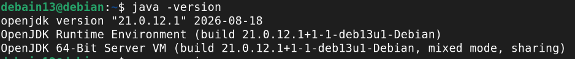
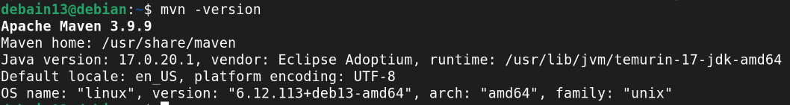

# Lab08 — Mockito

**Оюутан:** Н.Мөнхбаяр 
**Код:** B242270058 

---

## 1. Орчны мэдээлэл

java -version
21.0.12.1

maven -version
Apache Maven 3.9.9

---

## 2. Тестийн тоо

`results/mvn-test.txt` файлын сүүлийн `Tests run:` мөрийн дагуу **нийт 10 тест** амжилттай ажилласан.
Tests run: 10, Failures: 0, Errors: 0, Skipped: 0
BUILD SUCCESS

---

## 3. A8-ийн `lenient()` тайлбар

A8 тестэд мөр бүр өөр stub ашигладаг. Тухайн мөр ажиллахад бусад мөрийн stub-ууд ашиглагдахгүй үлддэг тул Mockito-гийн **strict stubs** горим `UnnecessaryStubbingException` алдаа өгдөг. Иймд `lenient()`-оор тэдгээрийг зөвшөөрсөн — ингэснээр ашиглагдаагүй stub-ууд алдаа үүсгэхгүй.

``java
lenient().when(repo.findById(any())).thenReturn(Optional.of(student));
4. Хэсэг B — Мутацийн хүснэгт
4.1 Мутант 1 — !student.active() комментыг хассан
Эвдрэл: CourseRegistrationService.java дотор идэвхгүй оюутныг шалгах if (!student.active()) нөхцөлийг коммент болгосон.

mvn-test-mutant-1.txt-ийн бодит гаралт:

Tests run: 10, Failures: 2, Errors: 0, Skipped: 0
BUILD FAILURE

Failures:
  гурванАлдааныАнги_параметржүүлсэн[2]:133
    expected: <ERROR_INACTIVE_STUDENT> but was: <OK>
  идэвхгүйОюутанд_ERROR_INACTIVE_STUDENT_имэйлтэйХарьцахгүй:60
    expected: <ERROR_INACTIVE_STUDENT> but was: <ERROR_NO_COURSE>
Тест	Үр дүн	Тайлбар
гурванАлдааныАнги_параметржүүлсэн[2]	❌ Fail	ERROR_INACTIVE_STUDENT хүлээсэн ч OK гарсан
идэвхгүйОюутанд_ERROR_INACTIVE_STUDENT_имэйлтэйХарьцахгүй	❌ Fail	ERROR_INACTIVE_STUDENT хүлээсэн ч ERROR_NO_COURSE гарсан
Бусад 8 тест	✅ Pass	Энэ мутантад нөлөөлөхгүй
Илрүүлсэн: 2 тест (A3, A8)

4.2 Мутант 2 — saveRegistration дуудалтыг хассан
Эвдрэл: CourseRegistrationService.register() дотор repository.saveRegistration(studentId, courseId) дуудалтыг коммент болгосон.

mvn-test-mutant-2.txt-ийн бодит гаралт:

Tests run: 10, Failures: 2, Errors: 0, Skipped: 0
BUILD FAILURE

Failures:
  идэвхтэйОюутанБүртгүүлэхэд_OK_буцаж_хадгалж_имэйлИлгэнэ:40
    Wanted but not invoked: repository.saveRegistration("S1", "C1")
  имэйлИлгээгчШидсэнЧ_бүртгэл_OK_хадгалалтХийгдсэн:87
    Wanted but not invoked: repository.saveRegistration("S4", "C1")
Тест	Үр дүн	Тайлбар
идэвхтэйОюутанБүртгүүлэхэд_OK_буцаж_хадгалж_имэйлИлгэнэ	❌ Fail	saveRegistration("S1", "C1") дуудагдахыг verify хийсэн ч дуудагдаагүй
имэйлИлгээгчШидсэнЧ_бүртгэл_OK_хадгалалтХийгдсэн	❌ Fail	saveRegistration("S4", "C1") дуудагдахыг verify хийсэн ч дуудагдаагүй
Бусад 8 тест	✅ Pass	Энэ мутантад нөлөөлөхгүй
Илрүүлсэн: 2 тест (A1, A5)

A7 яагаад унасангүй вэ? mvn-test-mutant-2.txt-д A7 гэсэн failure байхгүй. Учир нь A7 тест нь saveRegistration()-ийг verify хийдэггүй — зөвхөн emailService.sendWelcome()-ийг verify хийдэг. Мутант 2 нь saveRegistration дуудалтыг хассан ч, A7 нь түүнийг шалгадаггүй тул унасангүй.

Тестийн сул тал: A7-д verify(repository).saveRegistration(any(), any()) нэмэх шаардлагатай — ингэснээр мутант 2-ыг илрүүлэх боломжтой болно.

4.3 Мутант 3 — courseId == null шалгалтыг устгасан
Эвдрэл: CourseRegistrationService.register() дотор if (courseId == null) throw new IllegalArgumentException(...) шалгалтыг устгасан.

mvn-test-mutant-3.txt-ийн бодит гаралт:

Tests run: 10, Failures: 1, Errors: 0, Skipped: 0
BUILD FAILURE

Failures:
  nullОролтод_IllegalArgumentException_хамаарлуудтайХарьцахгүй:93
    Expected java.lang.IllegalArgumentException to be thrown, but nothing was thrown.
Тест	Үр дүн	Тайлбар
nullОролтод_IllegalArgumentException_хамаарлуудтайХарьцахгүй	❌ Fail	IllegalArgumentException хүлээсэн ч юу ч шидэгдээгүй
Бусад 9 тест	✅ Pass	Энэ мутантад нөлөөлөхгүй
Илрүүлсэн: 1 тест (A6)

4.4 Хураангуй хүснэгт
Мутант	Эвдрэл	Унасан тестүүд	Тоо
1	!student.active() коммент	гурванАлдааныАнги_параметржүүлсэн[2], идэвхгүйОюутанд_ERROR_INACTIVE_STUDENT_имэйлтэйХарьцахгүй	2
2	saveRegistration коммент	идэвхтэйОюутанБүртгүүлэхэд_OK_буцаж_хадгалж_имэйлИлгэнэ, имэйлИлгээгчШидсэнЧ_бүртгэл_OK_хадгалалтХийгдсэн	2
3	courseId == null устгасан	nullОролтод_IllegalArgumentException_хамаарлуудтайХарьцахгүй	1
Нийт: Бүх 3 мутантыг дор хаяж нэг тест илрүүлсэн. Мутант 2-ыг A7 илрүүлээгүй — энэ нь тестийн сул тал бөгөөд A7-д saveRegistration-ийг verify хийх шаардлагатай.

5. Файлын бүтэц

lab08
|-- .gitignore
|-- pom.xml
|-- README.md
|-- Screenshot/
|   |-- java-version.png
|   `-- maven-version.png
|-- results/
|   |-- mvn-test.txt
|   |-- mvn-test-mutant-1.txt
|   |-- mvn-test-mutant-2.txt
|   `-- mvn-test-mutant-3.txt
|-- src/
|   |-- main/java/...
|   `-- test/java/...
`-- target/             

6. Дүгнэлт
Mock объект нь гадаад хамаарлыг (сан, SMTP) бодит хэрэгжүүлэлтгүйгээр тусгаарлаж тестлэх боломж олгодог бол гараар бичсэн fake нь интерфейсийн бүх методыг хэрэгжүүлэх шаардлагатай бөгөөд илүү код бичих шаардлагатай. Гэхдээ fake нь илүү уншигдахуйц, зан төлөвийг тодорхой илэрхийлдэг давуу талтай. Юуг mock хийх ёсгүй вэ гэвэл — утга бүрдүүлэгч (value object), record, энгийн utility класс зэргийг mock хийх нь илүүдэл бөгөөд бодит объект ашиглах нь дээр. verify-г хэтрүүлэн ашиглавал тест нь хэрэгжүүлэлтийн дэлгэрэнгүй мэдээлэлд хэт холбогдож, refactoring хийхэд эмзэг болдог — өөрөөр хэлбэл "хамаг хэт холбогдол" үүсдэг. Мөн зарим verify нь бизнес шаардлага биш, харин дотоод дуудлагыг шалгаж байгаа тохиолдол гардаг. Мутацийн шинжилгээ нь тестийн чанарыг шалгах сайн арга бөгөөд аль ч тест унагаадаггүй эвдрэл нь тестийн цоорхойг илтгэнэ. Энэ лабораторид бичсэн тестүүд 3 мутантыг барьж чадсанаар логикийн гол салбаруудыг зөв шалгаж байгааг баталлаа — гэхдээ A7-ийн saveRegistration verify дутуу байгаа нь мутант 2-ын бүрэн илрүүлэлтийг хангаагүй.

